


**Sanoat korxonasi uchun kameralar orqali ishlaydigan AI xavfsizlik nazorati.** Tizim video oqimida odam, transport, olov, qurol va himoya vositalarini aniqlaydi, zona qoidalari buzilganini qayd etadi va hodisani operator tasdig'iga yuboradi. Butun tizim korxonaning ichki tarmog'ida ishlaydi va internetga chiqmaydi.

---

## Operator qanday ishlaydi

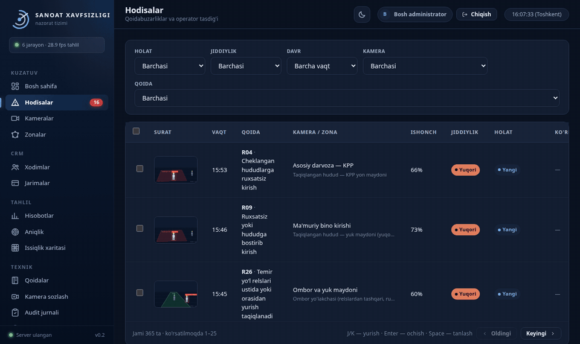

AI hodisani o'zi jarima qilib yozmaydi, har bir hodisa operator qaroridan o'tadi:

1. Hodisa oynasida qoida, kamera, zona, ishonch darajasi va AI tafsilotlari ko'rinadi.
2. Operator `C` tugmasi bilan tasdiqlaydi, `X` bilan rad etadi yoki `R` bilan keyinga qoldiradi. Rad etishda sabab yozish majburiy.
3. Qarordan keyin keyingi hodisa o'zi ochiladi. Jarima faqat tasdiqlangan hodisaga yoziladi, miqdorini esa admin qoida sozlamasida belgilaydi.

## Asosiy imkoniyatlar

| | |
|---|---|
| 🎯 **Kaskad detektor** | Asosiy model (YOLOX-nano) har kadrda odam va transportni topadi. Olov va tutun, himoya vositalari (kaska, jilet, niqob, qo'lqop, ko'zoynak), qurol va chekish modellari o'z oralig'ida ishga tushadi. Hammasi ONNX Runtime orqali ishlaydi |
| 🧭 **Treker** | Odamlar kadrdan kadrga CBIoU usuli bilan kuzatiladi. Bu usul 5 kadr/s da tez yurgan odamni ham yo'qotmaydi, shuning uchun bitta odamning qoidabuzarligi bir marta yoziladi |
| 📐 **Zona muharriri** | Taqiqlangan hudud, piyoda yo'lagi, panjara chizig'i, to'xtash joyi, kran osti va post zonalari kadr ustida chiziladi. Ishchi o'zgarishni qayta ishga tushirishsiz 10–15 soniyada oladi |
| 📏 **12 ta qoida dvigateli** | Zonaga kirish, chiziqni kesish, yo'lakdan chiqish, postda yo'qlik, transport to'xtashi, yuk ostida turish, himoya vositasi yo'qligi, olov, tezlik, yugurish, qurol va chekish uchun alohida dvigatel bor. Katalogda 75 ta talab, ulardan 39 tasining dvigateli yozilgan |
| 🔫 **Qurol uchun ikkinchi fikr** | Qurol nomzodi 2 soniya tursa, kesim CLIP modeli bilan qayta tekshiriladi. Telefon, otvyortka va asboblar sabab bo'ladigan soxta signal shu bosqichda to'xtaydi |
| ⚡ **Yuklamani tejash** | Harakat darvozasi bo'sh sahnada modelni ishlatmaydi. Barcha kameralar bitta model xizmatini ustuvorlik navbati bilan bo'lishadi. Og'ir model sinovdan o'tgan bo'lsa, 8 bitli (INT8) variantda ishlaydi |
| ✅ **Operator tasdig'i** | Hodisalar navbati, klaviatura bilan tezkor qaror, ommaviy amallar, jonli SSE kanal va A4 formatdagi dalil varag'i (PDF) bor |
| 📊 **Aniqlik va issiqlik xaritasi** | Har qoida uchun aniqlik operator qarorlaridan hisoblanadi va ishonch chegarasi tavsiya qilinadi, lekin avtomatik qo'llanmaydi. Issiqlik xaritasi qoidabuzarlik qaysi joyda va qaysi soatda to'planishini ko'rsatadi |
| 💼 **Jarima CRM** | Xodimlar reyestri, jarima holatlari (kutilmoqda, qo'llangan, bekor), Excel hisobotlar (hodisalar, jarimalar, umumiy statistika) |
| 🛡️ **Ishonchlilik** | Watchdog osilib qolgan ishchini qayta ishga tushiradi. Disk to'lsa klip yozish to'xtaydi, lekin hodisa yo'qolmaydi. Har kuni avtomatik zaxira olinadi. Kirish PIN orqali, rollar admin, operator va kuzatuvchi, har amal audit jurnaliga yoziladi |

## Ekranlar

<table>
<tr>
<td width="50%">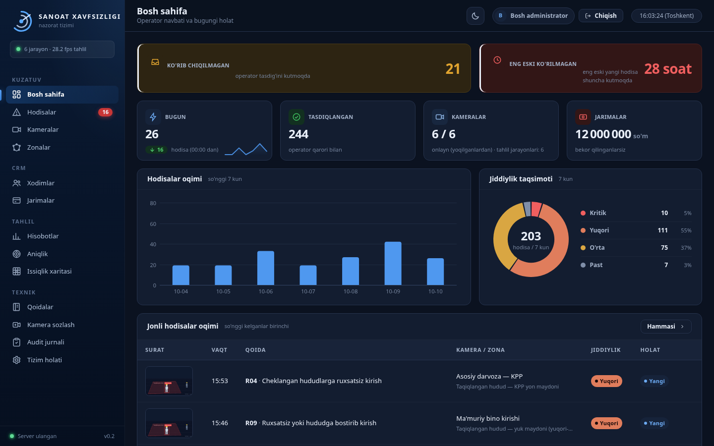 <b>Bosh sahifa</b>: ko'rib chiqilmagan hodisalar, 7 kunlik oqim, jiddiylik taqsimoti</td>
<td width="50%">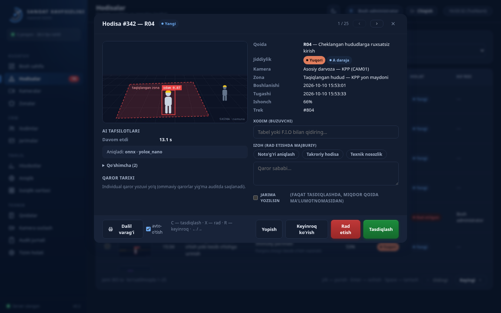 <b>Hodisa oynasi</b>: AI tafsilotlari, buzuvchi xodim, qaror sababi va jarima</td>
</tr>
<tr>
<td>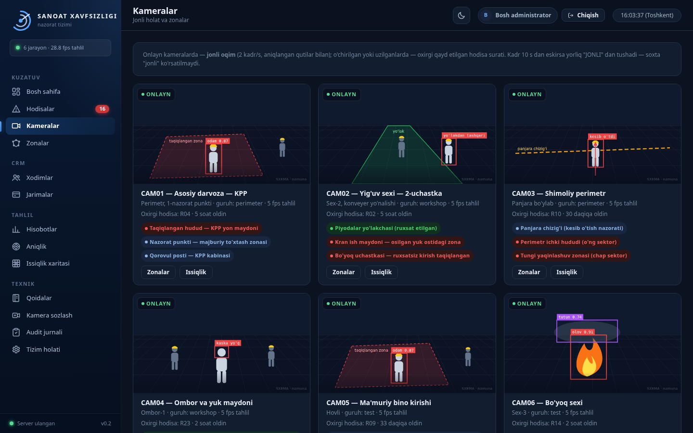 <b>Kameralar</b>: holat, tahlil tezligi, zonalar va oxirgi hodisa</td>
<td>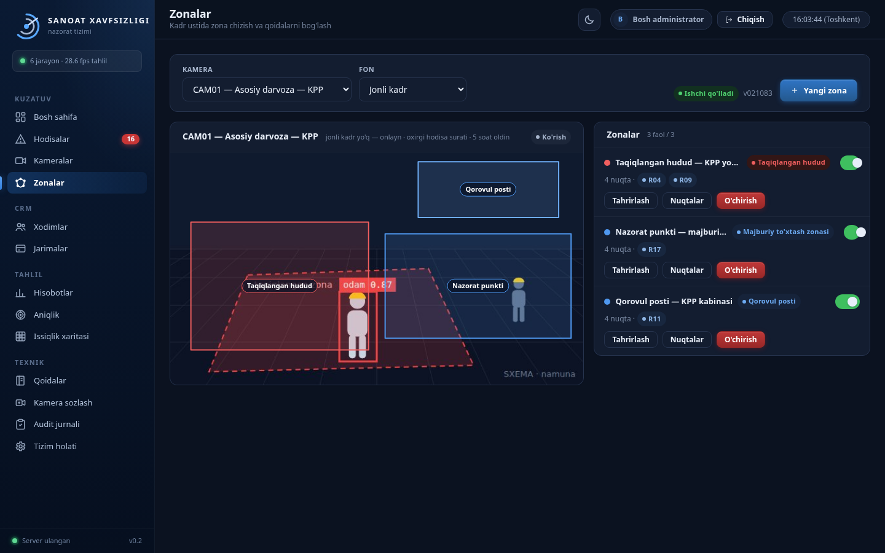 <b>Zona muharriri</b>: kadr ustida chizish, zona qoidalari va ishchi qo'llagan versiya</td>
</tr>
<tr>
<td>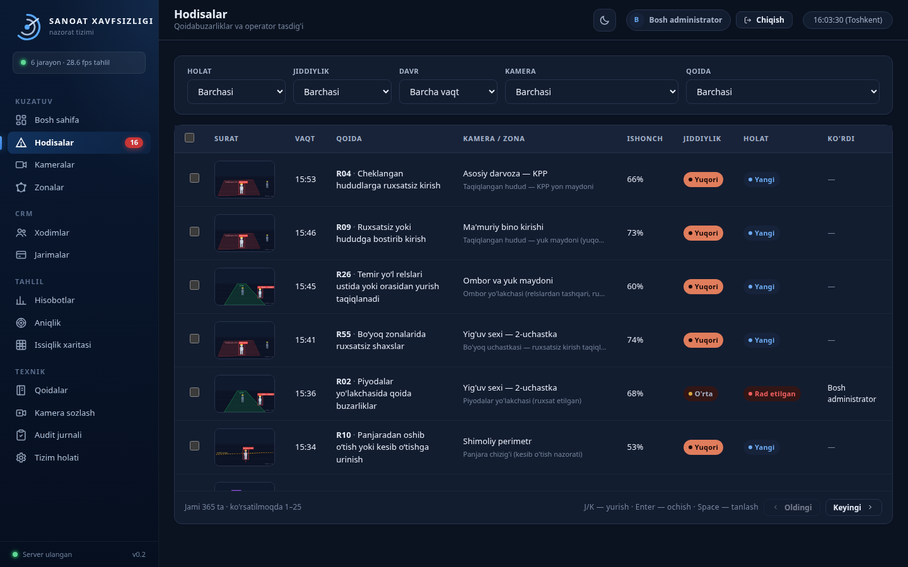 <b>Hodisalar</b>: filtrlar, ishonch, jiddiylik va qaror holati</td>
<td>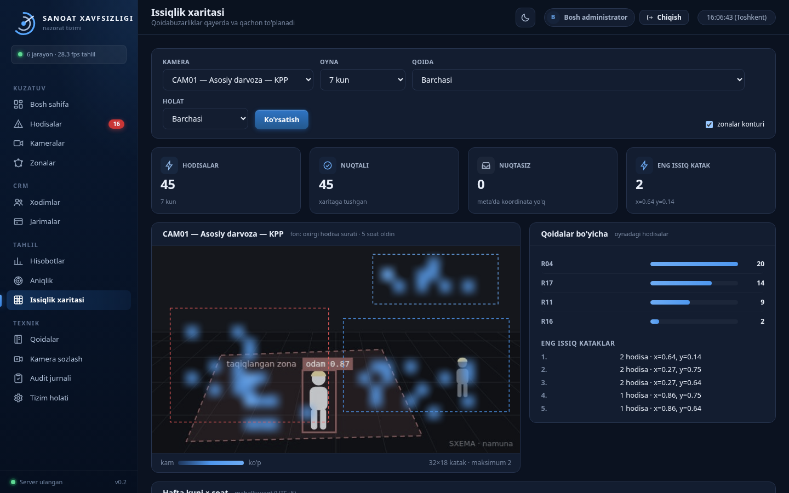 <b>Issiqlik xaritasi</b>: qoidabuzarlik to'planadigan joylar</td>
</tr>
<tr>
<td>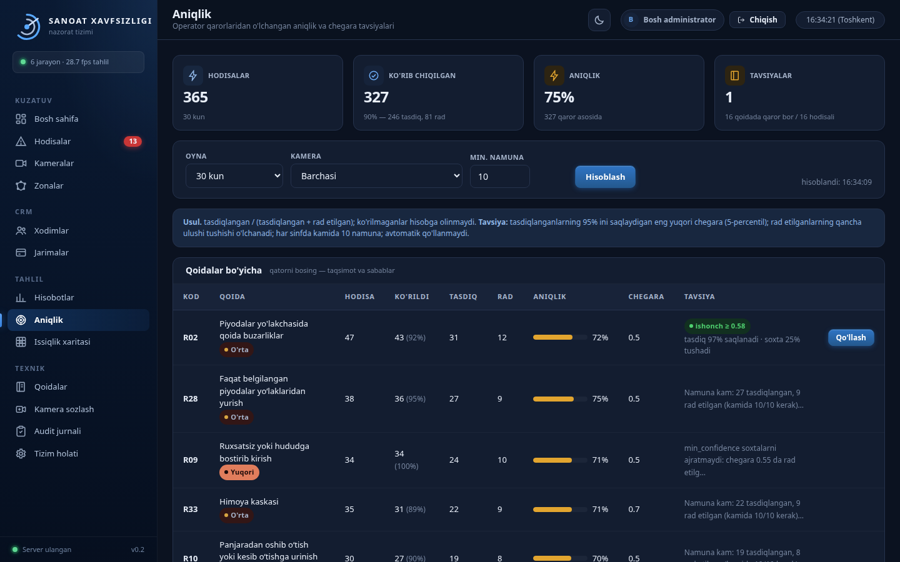 <b>Aniqlik</b>: operator qarorlaridan o'lchangan aniqlik va chegara tavsiyasi</td>
<td>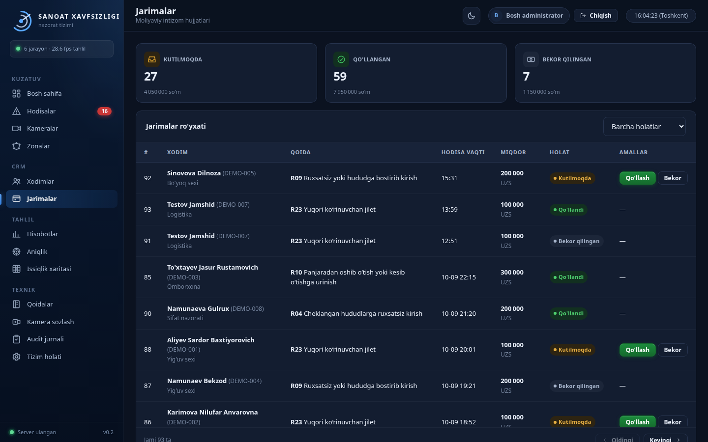 <b>Jarimalar</b>: tasdiqlangan hodisalar bo'yicha intizom hujjatlari</td>
</tr>
<tr>
<td>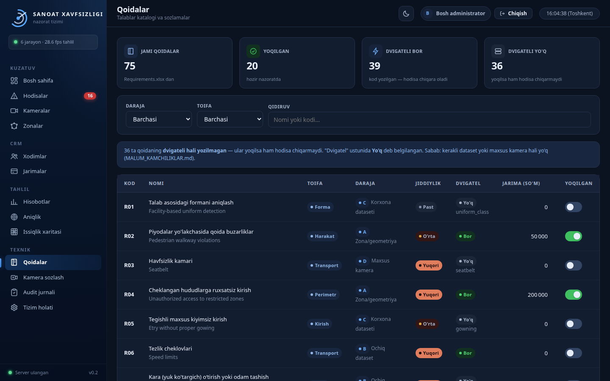 <b>Qoidalar katalogi</b>: daraja, jiddiylik, dvigatel bor-yo'qligi va jarima miqdori</td>
<td>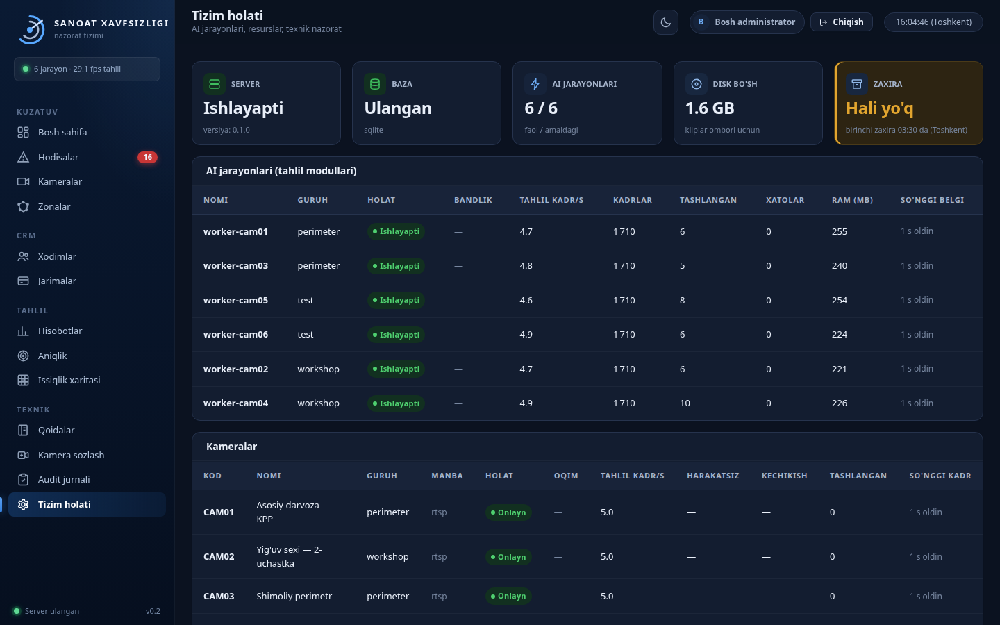 <b>Tizim holati</b>: AI jarayonlari, tahlil tezligi, tashlangan kadrlar, kameralar</td>
</tr>
</table>

> Suratlardagi barcha hodisalar, xodimlar, kameralar va summalar **namuna ma'lumot**. Kadr o'rnidagi tasvirlar **sintetik sxema** (zona, odam belgisi, ramka) bo'lib, haqiqiy kamera tasviri emas. Haqiqiy kadr va xodim yuzlari ataylab ko'rsatilmagan.

## Arxitektura

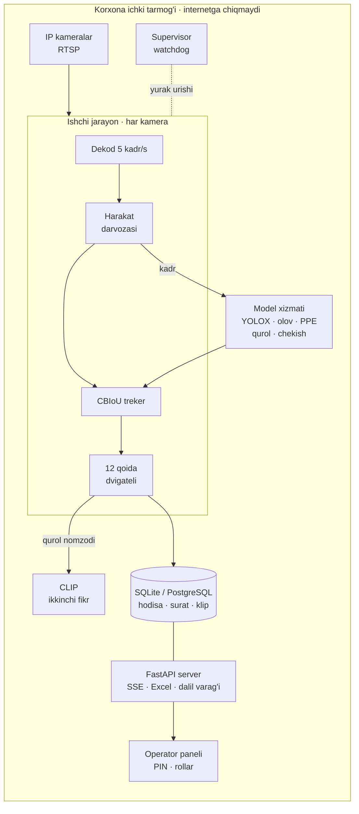

- **Ishchi** har kamera uchun alohida jarayonda ishlaydi va bazaga yurak urishini yozadi. Supervisor javob bermay qolgan ishchini to'xtatib, qayta ishga tushiradi.
- **Model xizmati** barcha kameralarning kadrini bitta umumiy navbatda ko'radi. Ustuvorlik tartibi: olov → asosiy model → qurol → chekish → PPE. Qurol, chekish va PPE modellari faqat kadrda odam bo'lganda ishga tushadi.
- **Ko'p kompyuter:** kameralar bir nechta tahlil kompyuteriga taqsimlanadi, panel va baza esa bitta qoladi.
- **O'rnatish:** Ubuntu `.deb` paketi (systemd xizmati) yoki Docker Compose (CPU va NVIDIA GPU varianti). Tizim faqat korxona ichidagi serverda ishlaydi.

## Sifat

- `unittest` — **471 ta sinov** (3 tasi o'tkazib yuborilgan), haqiqiy ONNX modellari bilan: detektor, treker, qoida dvigatellari, harakat darvozasi, model xizmati, INT8, qurol tasdig'i, zona issiq yuklash, aniqlik, API va integratsiya.
- Treker alohida o'lchov skripti bilan tekshiriladi: aniq javobi ma'lum sun'iy holat haqiqiy qoida dvigatelidan o'tkaziladi, o'tkazib yuborilgan va takror yozilgan hodisalar alohida sanaladi.
- Halollik qoidasi: model yuklanmasa tizim jimgina «soxta» detektorga o'tmaydi, ochiq xato beradi. Tekshirilmagan qurol hodisasi «tasdiqlanmagan» belgisi bilan chiqadi.

## Texnologiyalar

Python 3.14 · ONNX Runtime · OpenCV · NumPy · YOLOX / YOLOv8 · CLIP ViT-B/32 (INT8) · FastAPI · Uvicorn · SQLAlchemy Core · SQLite / PostgreSQL · openpyxl · sof HTML/JS panel (build'siz, CDN'siz) · Docker · Debian paketi

---

**Manba kodi yopiq.** Namoyish yoki hamkorlik bo'yicha: Telegram [@Humoyun_Davronov](https://t.me/Humoyun_Davronov)

Muallif — Humoyun Davronov

